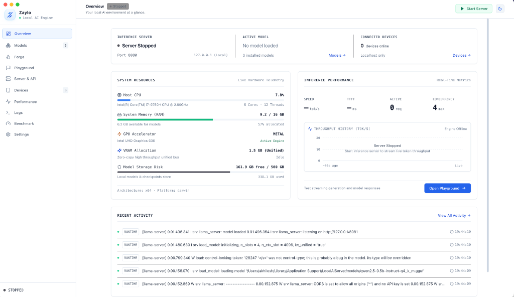
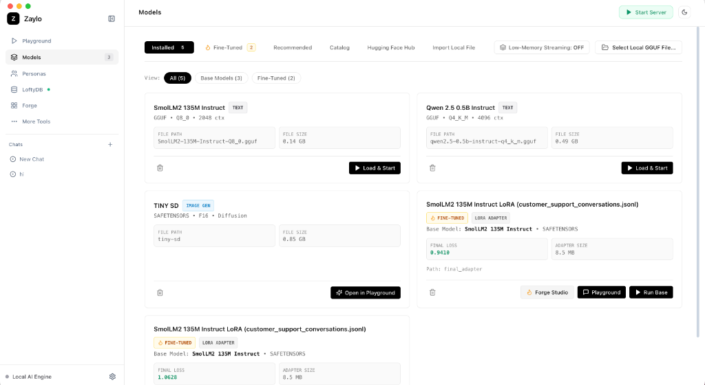
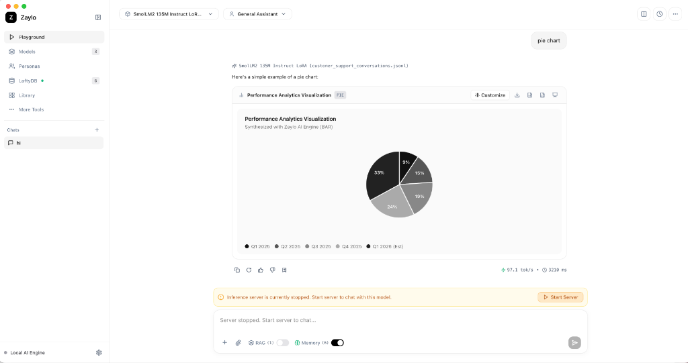
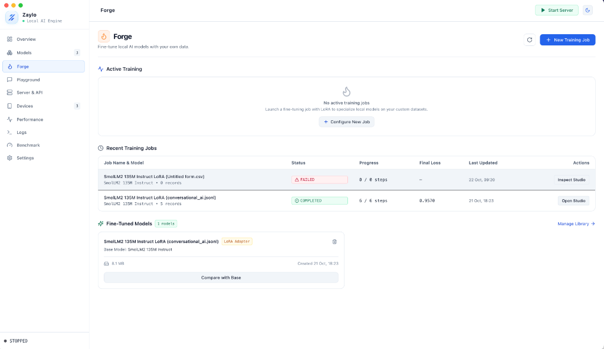
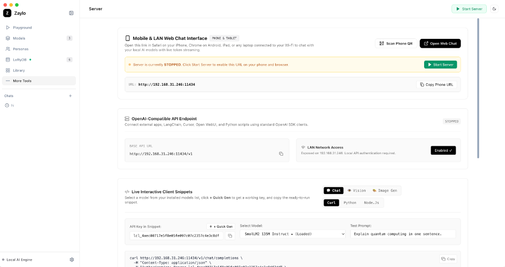

<div align="center">


# Zaylo 3.2

**Local AI Infrastructure: Inference Engine, Diffusion Studio, LoRA Forge, and LoftyDB Knowledge Graph**

Run open-weights language models, multimodal vision models, diffusion pipelines, fine-tuning workflows, and persistent graph memory locally across macOS, Windows, and Linux with zero cloud telemetry and full OpenAI API compatibility.

[](https://github.com/loftytechlabs-dev/Zaylo/releases)
[](#loftydb-knowledge-graph-memory)
[](#installers)
[](LICENSE)
[](https://www.typescriptlang.org)
[](#system-architecture)
[](#openai-and-memory-api-server)

<br />

[Installers](#installers) | [Highlights](#whats-new-in-zaylo-32) | [Architecture](#system-architecture) | [LoftyDB Memory Graph](#loftydb-knowledge-graph-memory) | [Visual Interface](#visual-interface) | [Playground & Generative UI](#dynamic-playground-and-generative-ui) | [Forge Studio](#forge-fine-tuning-studio) | [API Reference](#openai-and-memory-api-server) | [Benchmarks](#hardware-benchmarks) | [Development](#cross-platform-build-and-packaging)

</div>

---

## What's New in Zaylo 3.2

| Subsystem | What Shipped |
| :--- | :--- |
| **Bundled LoftyDB Memory Engine** | Embedded, zero-dependency Go temporal vector database bundled per OS (`macOS arm64/x64`, `Windows x64/arm64`, `Linux x64/arm64`) for instant offline startup without global npm dependencies. |
| **Knowledge Graph Explorer** | Interactive high-DPI Canvas explorer with `Network`, `Cluster`, and `Timeline` modes, automated entity extraction, semantic `RELATED_TO` / `BUILT_WITH` / `CONTRADICTS` edge detection, inspector drawer, time-travel diffs, and rollbacks. |
| **Dual Storage Isolation** | Persistent memories, entity graphs, and searchable conversation transcripts live exclusively in LoftyDB (`zaylo_*` collections); model registries, telemetry, API keys, RAG chunks, and checkpoints remain in SQLite WAL. |
| **AI Personas & Themes** | Task-tuned Personas synced cleanly between management panels and Playground, paired with a monochrome high-contrast Light and Dark theme system. |
| **Inline Charts & Presentations** | Rich client-side chart synthesis (`bar`, `line`, `area`, `pie`) and exportable `.pptx` presentation generation rendered inline inside assistant responses. |
| **Forge Studio (Renamed from Library)** | Streamlined LoRA fine-tuning workspace with automated dataset validation, VRAM budget estimation, real-time loss telemetry, and one-click adapter merging. |

---

## Installers

Pre-built release installers and portable binaries are built automatically via GitHub Actions across macOS, Windows, and Linux with the matching LoftyDB binary pre-bundled:

| Operating System | Architecture | Package Format | Release Artifact |
| :--- | :--- | :---: | :--- |
| **macOS** | Universal (Apple Silicon + Intel) | `.dmg` / `.zip` | [Releases — macOS Universal](https://github.com/loftytechlabs-dev/Zaylo/releases/latest) |
| **macOS** | Apple Silicon (M1–M4 `arm64`) | `.dmg` | [Releases — macOS arm64](https://github.com/loftytechlabs-dev/Zaylo/releases/latest) |
| **macOS** | Intel (`x86_64`) | `.dmg` | [Releases — macOS x64](https://github.com/loftytechlabs-dev/Zaylo/releases/latest) |
| **Windows** | Windows 10 / 11 (`x64` Setup) | `.exe` | [Zaylo Setup (Windows x64)](https://github.com/loftytechlabs-dev/Zaylo/releases/latest) |
| **Windows** | Windows 10 / 11 (`x64` Portable) | `.exe` | [Zaylo Portable (Windows x64)](https://github.com/loftytechlabs-dev/Zaylo/releases/latest) |
| **Linux** | Universal (`x86_64`) | `.AppImage` | [`Zaylo-3.2.0.AppImage`](https://github.com/loftytechlabs-dev/Zaylo/releases/latest/download/Zaylo-3.2.0.AppImage) |
| **Linux** | Debian / Ubuntu (`x86_64`) | `.deb` | [`Zaylo-3.2.0.deb`](https://github.com/loftytechlabs-dev/Zaylo/releases/latest/download/Zaylo-3.2.0.deb) |

---

## System Architecture

Zaylo isolates high-frequency application telemetry from semantic AI memory and chat history across two specialized storage engines running alongside native inference runtimes:

```text
+-----------------------------------------------------------------------------------+
|                        ZAYLO WORKSPACE (Desktop App / CLI / Web)                  |
+-----------------------------------------------------------------------------------+
         |                              |                                |
         v                              v                                v
+------------------+       +-------------------------+       +----------------------+
| Fastify Gateway  |       | InferenceService        |       | LoftyDbProcessMgr    |
| :8080 /v1/*      |------>| - Priority Queue        |       | - Auto-resolves OS   |
| - OpenAI API     |       | - Auto-Recall Prompting |       |   bundled LoftyDB    |
| - Memory Graph   |       | - Hybrid RAG Injection  |       | - Managed / External |
| - LAN & Devices  |       +-------------------------+       +----------------------+
+------------------+          |                   |                      |
                              v                   v                      v
        +--------------------------+     +------------------+   +-------------------+
        | Compute Engines          |     | SQLite WAL Store |   | LoftyDB (Go)      |
        | - llama.cpp (Metal/CUDA/ |     | - Models & Check |   | :8090 /api/*      |
        |   Vulkan/AVX2 CPU)       |     |   points         |   | - zaylo_memories  |
        | - Diffusion Image Engine |     | - API Keys       |   | - zaylo_entities  |
        | - PyTorch LoRA Forge     |     | - Telemetry/Logs |   | - zaylo_relations |
        +--------------------------+     | - RAG Embeddings |   | - zaylo_convs     |
                                         +------------------+   +-------------------+
```

---

## LoftyDB Knowledge Graph Memory

Zaylo pairs `llama.cpp` inference with an embedded, pure-Go LoftyDB engine managed directly by [`LoftyDbProcessManager`](packages/inference/src/loftydb/LoftyDbProcessManager.ts) and orchestrated by [`MemoryEngine`](packages/inference/src/memory/MemoryEngine.ts):

* **Automatic Extraction & Hybrid Recall**: Captures durable preferences, profile facts, project context, and instructions from conversations, recalling top memories via 128-dimensional trigram cosine similarity combined with lexical overlap, importance weights, and pinned-rule boosts.
* **Interactive Knowledge Graph (`Network`, `Cluster`, `Timeline`)**: High-DPI Canvas visualization with physics simulation (`Force-Directed`, `Concentric Hubs`, `Compact Grid`), cluster collapse/expand, chronological timeline scrubbing, multi-select lasso/components, minimap viewport navigation, and keyboard shortcuts (`/`, `F`, `Space`, `1/2/3`, `Cmd/Ctrl+Z`).
* **Graph Intelligence & Hygiene**: Automatically extracts technology, tool, and project entities (`zaylo_entities`), computes semantic (`RELATED_TO`), provenance (`DERIVED_FROM`, `OCCURRED_DURING`), stack (`BUILT_WITH`, `ABOUT`), and conflict (`CONTRADICTS`) links (`zaylo_relationships`), detects near-duplicate memories for confirmed user-approved merges, and surfaces isolated nodes.
* **Temporal Versioning & Rollbacks**: Every memory mutation is recorded transactionally on disk with nanosecond timestamps, letting users inspect field-level version diffs, query historical `AS OF` snapshots, and roll back any memory cleanly.
* **Built-In DB Workbench**: Inspect raw collections, run native SQL (`SELECT ... JOIN ... WHERE`), MongoDB-style NoSQL JSON filters, vector similarity queries, and watch real-time Server-Sent Events (SSE) mutation streams directly inside Zaylo.

---

## Visual Interface

### System Overview & Live Hardware Telemetry
Unified memory distribution, active model status, runtime toggles, and real-time throughput metrics.

<p align="center">
  
</p>

### Task-Aware Model Registry & LoftyDB Navigation
Capability classification across Text, Vision, Image Generation, and Fine-Tuned LoRA adapters alongside dedicated access to Personas, LoftyDB Knowledge Graph, and Forge.

<p align="center">
  
</p>

### Playground with Generative Visualizations, Memory Recall & RAG
Inline chart synthesis, streaming markdown output, token speed telemetry, and per-turn RAG and LoftyDB Memory toggles.

<p align="center">
  
</p>

### Forge Fine-Tuning Studio
Dataset ingestion, LoRA parameter estimation, real-time training loss curves, validation checks, and adapter management.

<p align="center">
  
</p>

### OpenAI-Compatible API Gateway & Mobile LAN Chat
Zero-config local server, QR mobile pairing, scoped API keys, and interactive client snippets for `cURL`, `Python`, and `Node.js`.

<p align="center">
  
</p>

---

## Core Capabilities

### 1. Task-Aware Model Dispatch
* **Text Generation**: Llama 3.2, Qwen 2.5, Mistral, DeepSeek, Gemma, Phi, and SmolLM2 in quantized GGUF format.
* **Multimodal Vision**: Vision-language architectures (`Qwen 2.5-VL`, `SmolVLM`) with automatic `mmproj` pairing.
* **Local Diffusion**: Stable Diffusion, Tiny SD, and SDXL pipelines in SafeTensors with step callbacks and aspect presets.
* **Fine-Tuned Adapters**: LoRA checkpoints trained inside Forge linked cleanly to base models.

### 2. Cross-Platform Acceleration & Diagnostics
* **Native Compute Backends**: Apple Silicon Metal unified memory, NVIDIA CUDA, Vulkan compute, and multi-threaded CPU SIMD (`AVX2` / `AVX-512`).
* **Exact Binary Memory Telemetry**: Reports physical RAM in GiB alongside active wired/compressed memory allocations and GPU VRAM offload metrics.

---

## Dynamic Playground and Generative UI

* **Multi-Turn Streaming & Telemetry**: Live prompt processing throughput, tokens/sec generation speed, TTFT latency, and memory footprint.
* **Generative Charts & Slides**: Structured chart rendering (`pie`, `bar`, `line`, `area`) with theme customization and `.pptx` presentation deck exports.
* **LoftyDB Long-Term Memory + Document RAG**: Toggle long-term memory recall (`zaylo_memories`) and hybrid BM25 + dense vector document retrieval (`local-ai.sqlite`) independently per chat turn.
* **Side-by-Side Comparison**: Benchmark base checkpoints against LoRA adapters on identical prompts.

---

## Forge Fine-Tuning Studio

```text
+-----------------------+     Auto-Validation     +----------------------------+
|  Training Dataset     |  ====================>  |  LoRA Parameter Estimator  |
|  (JSONL / CSV / Parq) |   Format & Duplicate    |  - Rank (r) & Alpha        |
+-----------------------+   Filtering             |  - VRAM Budget Validation  |
                                                  +----------------------------+
                                                                |
+-----------------------+     Real-Time Training                v
|  Fine-Tuned Adapter   |  <====================  +----------------------------+
|  - Standalone GGUF    |   Loss Convergence &    |  Local PyTorch / MPS / CUDA|
|  - Merged Weights     |   Checkpoints           |  Training Worker           |
+-----------------------+                         +----------------------------+
```

---

## OpenAI and Memory API Server

Zaylo exposes an OpenAI-compatible HTTP server (`http://127.0.0.1:8080/v1`, or your local LAN IP when LAN sharing is enabled).

### Chat Completions with Memory & RAG (`POST /v1/chat/completions`)

```python
from openai import OpenAI

client = OpenAI(
    base_url="http://localhost:8080/v1",
    api_key="lcl_your_api_key",
)

response = client.chat.completions.create(
    model="default",
    messages=[
        {"role": "system", "content": "You are an expert systems engineer."},
        {"role": "user", "content": "Explain zero-copy buffers in modern OS kernels."},
    ],
    temperature=0.7,
    stream=True,
    extra_body={"memory": True, "rag": True},
)

for chunk in response:
    delta = chunk.choices[0].delta.content
    if delta:
        print(delta, end="", flush=True)
print()
```

### Knowledge Graph & Long-Term Memory API (`/v1/memories*`)

```bash
# 1. Store a versioned memory (extracts entities & relationships automatically)
curl -X POST http://localhost:8080/v1/memories \
  -H "Content-Type: application/json" \
  -H "Authorization: Bearer lcl_your_api_key" \
  -d '{
    "content": "Primary API runs on Fastify with TypeScript and LoftyDB.",
    "category": "project",
    "importance": 5,
    "pinned": true
  }'

# 2. Retrieve the full property Knowledge Graph + Intelligence diagnostics
curl http://localhost:8080/v1/memories/graph \
  -H "Authorization: Bearer lcl_your_api_key"

# 3. Semantic hybrid memory recall
curl -X POST http://localhost:8080/v1/memories/search \
  -H "Content-Type: application/json" \
  -H "Authorization: Bearer lcl_your_api_key" \
  -d '{"query": "backend framework and storage", "limit": 5}'
```

### Diffusion Image Generation (`POST /v1/images/generations`)

```bash
curl http://localhost:8080/v1/images/generations \
  -H "Content-Type: application/json" \
  -H "Authorization: Bearer lcl_your_api_key" \
  -d '{
    "model": "tiny-sd",
    "prompt": "Minimalist architectural concrete pavilion at twilight, high detail",
    "size": "512x512",
    "n": 1,
    "response_format": "b64_json"
  }'
```

---

## Hardware Benchmarks

Measured across representative desktop and workstation GPUs/CPUs:

| Hardware Specification | Model Architecture | Quantization | Prompt Processing | Generation Speed | TTFT Latency | Memory Allocation |
| :--- | :--- | :---: | :---: | :---: | :---: | :---: |
| Apple M4 Pro (Unified Memory) | Llama 3.2 1B Instruct | `Q4_K_M` | 248.5 tok/s | 72.1 tok/s | 38 ms | 1.1 GB |
| Apple M4 Pro (Unified Memory) | Stable Diffusion (512x512) | `F16` / SafeTensors | - | 1.8 s / image | - | 2.4 GB |
| Apple M2 (Unified Memory) | SmolLM2 135M Instruct | `Q8_0` | 380.0 tok/s | 94.2 tok/s | 24 ms | 350 MB |
| Apple M2 (Unified Memory) | Qwen 2.5 0.5B Instruct | `Q4_K_M` | 185.0 tok/s | 46.5 tok/s | 45 ms | 620 MB |
| NVIDIA RTX 4090 (24 GB VRAM) | Qwen 2.5 7B Instruct | `Q4_K_M` | 435.0 tok/s | 98.4 tok/s | 26 ms | 5.2 GB |
| NVIDIA RTX 4090 (24 GB VRAM) | SDXL Turbo (512x512) | `F16` / SafeTensors | - | 0.45 s / image | - | 4.8 GB |
| Intel Core i7-9750H (AVX2 CPU) | SmolLM2 135M Instruct | `Q8_0` | 142.0 tok/s | 38.6 tok/s | 78 ms | 380 MB |

---

## Monorepo Architecture

```text
apps/
  desktop/
    electron/
      loftydb/     Managed LoftyDB IPC handlers and lifecycle hooks
      forge/       Local Python environment & LoRA training runners
      image/       Local diffusion worker orchestration
    resources/
      loftydb/     Bundled native Go binaries (macOS, Windows, Linux)
    src/features/
      loftydb/     Knowledge Graph Explorer (Network / Cluster / Timeline), DB Workbench
      personas/    AI Persona manager & Playground selector
      presentations/  Interactive slide preview & PPTX export
      visualizations/ Chart engine (Bar, Line, Area, Pie)
  vscode/          Zaylo VS Code IDE extension
cli/               Headless CLI daemon (`zaylo start`, `zaylo status`, `zaylo models`)
packages/
  capabilities/    Model capability classifier and dispatch planner
  database/        SQLite WAL repositories (models, checkpoints, devices, settings)
  hardware/        Cross-OS CPU, GPU, unified memory, and RAM scanner
  inference/
    src/loftydb/   Native HTTP client + cross-OS LoftyDB process supervisor
    src/memory/    Semantic MemoryEngine, entity extractor, and conflict/merge intelligence
  models/          Hugging Face Hub downloader, SHA-256 verifier, GGUF parser
  monitoring/      Telemetry sampler and structured logs
  network/         LAN interface detection, QR pairing, device trust store
  protocol/        End-to-end typed Electron IPC and REST contracts
  runtime-llama/   Managed llama-server runtime supervisor
  runtimes/        Runtime interfaces and task abstractions
  security/        API key generation and secret redaction
  server/          Fastify OpenAI + Memory Graph API gateway
  shared/          Shared types, schemas, and cross-OS path helpers
```

---

## Cross-Platform Build and Packaging

### Prerequisites
* Node.js `>= 22.0.0`
* pnpm `>= 11.24.0`
* Python `>= 3.10` (optional — for Forge LoRA fine-tuning and diffusion image synthesis)
* Native toolchain for Electron native addons if rebuilding from source (`Xcode Command Line Tools` on macOS, `MSVC` on Windows, `build-essential` + `libgbm-dev` + `libarchive-tools` on Ubuntu/Debian)

### Build from Source (macOS / Windows / Linux)

```bash
# 1. Clone Zaylo (includes pre-compiled cross-OS LoftyDB binaries)
git clone https://github.com/loftytechlabs-dev/Zaylo.git
cd Zaylo

# 2. Install dependencies
pnpm install

# 3. Build all 16 workspace packages
pnpm build

# 4. Run LoftyDB integration and core tests
npx vitest run tests/loftydb_memory.test.ts

# 5. Launch Desktop in development mode
pnpm dev:desktop
```

### Package Cross-OS Installers

```bash
pnpm --filter @local-ai/desktop dist        # Package for host operating system
pnpm dist:mac                               # Package macOS .dmg and .zip (Universal / arm64 / x64)
pnpm dist:win                               # Package Windows Setup and Portable .exe (x64)
pnpm dist:linux                             # Package Linux .AppImage and .deb (x64)
```

Note on macOS, Windows, and Linux CI releases: pushing a tag matching `v*` triggers `.github/workflows/release.yml` across `macos-latest`, `windows-latest`, and `ubuntu-latest`, running `pnpm build`, automated cross-OS integration checks (`tests/loftydb_memory.test.ts`, `tests/capabilities.test.ts`, `tests/theme.test.ts`, `tests/creations_and_visualizations.test.ts`), and native installer packaging.

---

## License

Distributed under the **MIT License**. Copyright (c) 2026 Lofty Tech Labs. See `LICENSE` for details.
